# BACK-16 — Kawalys integration journey, source capability matrix and trust pipeline (planning only)

Jira: [BACK-16](https://rahmaqanater.atlassian.net/browse/BACK-16) (parent BACK-1). Written 2026-11-18 on branch
`claude/back-16-integration-journey-09e41c` from Backstage-OS `main` at `96c2d7e` (BACK-14 #12 and BACK-15 #13 merged).

**This is a plan, not an implementation.** It changes nothing outside `docs/`. No code, package, credential, MCP
session, API call, data ingestion, database, agent, source write or Jira status change was made for it. It does not
revise any approved ADR, and it accepts none of the Proposed ones. Every implementation slice in §8 needs its own
ticket and its own owner approval.

It builds on, and cites rather than repeats:

- [BACK-7 G2 preflight](../BACK-7/README.md): `SourceAdapter` / `ReadResult` (ADR-04 §3), wire contract and GitHub
  normalisation (03), scope model (ADR-03), test plan N1–N17 (06), approval gate (07 §8).
- [BACK-14 reuse audit](../BACK-14/README.md): identity port and slices K-ID-0…K-AI-0 (§4, §7), MCP-first evaluation
  rule (§5), threat model (§3).
- [BACK-15 experience atlas](../BACK-15/README.md): screens, lenses and the five-step core flow (§2.5).
- Confluence: master proposal [Experience Atlas & Integration Journey v0](https://rahmaqanater.atlassian.net/wiki/spaces/KMC/pages/80052229)
  (Proposed) and the owner-approved [replaceable-providers ADR](https://rahmaqanater.atlassian.net/wiki/spaces/KMC/pages/80085048)
  (16 Nov 2026), both read 2026-11-18.

| Label | Meaning |
| --- | --- |
| **FACT** | Read from the repo at `96c2d7e`, from Jira / Confluence on 2026-11-18, or from a BACK-7 source with its fetch date. File or page named |
| **PROPOSAL** | A recommendation. Nothing is decided until the owner records it |
| **UNVERIFIED** | A provider or behaviour claim nobody has checked. Each says which document would confirm it |

**Process note (same as BACK-15 §8).** BACK-16's STOP list says "no … PRs". This docs-only PR rests on an owner
instruction relayed by the session that started this work. It is not recorded in Jira; the owner should confirm it on
the PR or in BACK-16.

## Hard rules that every section below keeps

1. **Read-only.** No source write, ever, before G4, and G4 is a separate gate (§6).
2. **Nothing is shown as live without a real read.** `synthetic: true` drives the demo marker and inert links today
   (`needsDemoMarker`, `isInertLink` in `app/src/contract/rules.ts`). A real read must carry `synthetic: false` *and*
   a successful `lastSuccessAt`; anything else stays unknown.
3. **Unknown is never Healthy.** Not configured, unavailable, restricted, stale, unread, unmapped and "no data found"
   all resolve to unknown or stale, never healthy (`resolveHealth`, `freshnessOf`, `countDisplay`).
4. **Source authority stays at the source.** GitHub, Jira and Confluence remain the masters. Port is optional
   context. Kawalys stores references and short-lived observations, never a second copy of authority.
5. **Isolation.** Server-side project scope on every read (BACK-7 ADR-03 §2). No Retail Tower credentials, tenant,
   identity, session or database (BACK-14 §3).

## Acceptance and deliverable map

| BACK-16 item | Section | Status |
| --- | --- | --- |
| Deliverable 1: diagram and capability matrix per source | §1, §2 | Drafted |
| Deliverable 2: per-source authority, fields, provenance, timestamps, scopes, identity / secret owner, MCP vs REST, pagination, rate limits, TTL, failure states, redaction, cost / egress; unverified marked | §2 | Drafted. Non-GitHub provider facts are **UNVERIFIED** (§2.3) |
| Deliverable 3: sequence G2a → G2e → G3 → G4 | §6 | Drafted |
| Deliverable 4: event / observation / relationship / view boundaries, duplicate and out-of-order policy, no guessed impact | §3, §5 | Drafted; storage depends on ADR-02 (open) |
| Deliverable 5: negative test matrix | §7 | Drafted; extends BACK-7 06 N1–N17 |
| Deliverable 6: small ticket proposals with stop / rollback / cost; ADRs still to decide | §8, §10 | Drafted |
| Acceptance 1: one traceable CI check → component → Jira issue → investigation → human decision path, with uncertainty and proof | §4 | Drafted on the INV-DEMO-7 fixture |
| Acceptance 2: no master authority moved from GitHub / Jira / Confluence; Port only optional | §2.1, §4, §9 R3 | Drafted. One gap found: authored map edges rest on Port today (§4.2) |
| Acceptance 3: MCP-first evaluation, REST / webhook fallback, no premature lock-in | §2.2, §6 | Drafted; follows BACK-14 §5, ADR-04 still Proposed |
| Acceptance 4: server-side project isolation, no shared Retail Tower credentials / tenant / auth / database | §3.4, §7, Hard rule 5 | Drafted |
| Acceptance 5: owner reviews and authorises each implementation slice | §8, §10 | Structure provided; **owner action pending** |

---

## 1. Integration journey

### 1.1 The path (FACT for the boundary named in the master proposal and ADR 80085048; PROPOSAL for the detail)

```mermaid
flowchart LR
  UI["React UI<br/>typed display contract<br/>no secrets, no source calls"]
  BFF["Kawalys BFF<br/>local user, role, project,<br/>environment scope (ADR-03)<br/>audit, cache, normalise"]
  PORT["SourceEvidencePort<br/>one per capability<br/>(G2 form: SourceAdapter + ReadResult,<br/>BACK-7 ADR-04 §3)"]
  ADP["One adapter per capability<br/>MCP evaluated first,<br/>REST / webhook if fit needs it"]
  SRC["GitHub · Jira · Sentry · Datadog ·<br/>Confluence · Port (optional)"]
  UI -- "HTTPS, GET only" --> BFF
  BFF -- "scope tuple checked first" --> PORT
  PORT --> ADP
  ADP -- "read-only credential,<br/>held server-side" --> SRC
  SRC -. "raw payload" .-> ADP
  ADP -. "ReadResult&lt;Raw*&gt;" .-> PORT
  PORT -. "Observation / EvidenceReference" .-> BFF
  BFF -. "wire contract (BACK-7 03 §3)" .-> UI
```



Plain-text form, for readers without Mermaid:

```
React UI ──GET──▶ BFF [auth → scope tuple → cache → normalise → rules → redact → audit]
                   └─▶ SourceEvidencePort (per capability)
                         └─▶ adapter (MCP | REST | webhook ingest)
                               └─▶ provider (read-only credential, server-side only)
```

- **Name.** The approved ADR 80085048 rule 1 names the boundary `SourceEvidencePort`. BACK-7 ADR-04 §3 already
  sketches its G2 shape as `SourceAdapter` with `ReadResult<T>`. **PROPOSAL:** treat them as one thing; the ADR name
  is the capability, `readChecks()` is its first method. Do not define a second interface.
- **One port per capability, not per vendor.** Checks (GitHub), work items (Jira), errors (Sentry), runtime signals
  (Datadog), decisions (Confluence), catalog context (Port). Each gets one provider and one offline fake (ADR 80085048
  rule 2). No universal plugin host.
- **MCP is never the security control.** ADR 80085048 rule 3. Read-only comes from the credential's scope, not from
  which tools the adapter calls (§2.2).

### 1.2 Where the journey stands today (FACT)

| Step | State at `96c2d7e` |
| --- | --- |
| React UI with typed display contract | Built, synthetic only (`app/src/contract/types.ts`, fixtures in `app/src/fixture/`) |
| Sources screen explaining connectivity vs freshness vs target health | Built, demo only (`#/sources`, copy in `app/src/i18n/screens/sources.ts`) |
| BFF, identity, scope | None. Proposed in BACK-7 ADR-01 / ADR-03 and BACK-14 §4 |
| Any adapter, credential or real read | None. The Sources copy says so in EN and AR: "nothing is connected and no credentials exist" |

---

## 2. Source capability matrix

### 2.1 Authority and minimum read (FACT for the `Provider` union and the Sources copy; PROPOSAL for the rest)

The six rows are exactly `Provider` in `app/src/contract/types.ts`. "Would read" is the existing copy in
`app/src/i18n/screens/sources.ts` (`integrations.provider`). Fixture TTLs are the values the synthetic world uses
(`app/src/fixture/world.ts`, `inv-demo-7.ts`). They are **synthetic FACTs, not proposed production values**.

Per-source `observedAt` field and production TTL (PROPOSAL; field names **UNVERIFIED** except GitHub, confirm per
§2.3): GitHub job `completed_at` else run `updated_at` (BACK-7 03 §6); Jira issue `updated`; Confluence page version
time; Sentry issue last-seen time; Datadog monitor last state change or query window end; Port entity update time.
Production TTLs are **open** and set per slice; the fixture TTLs below are a starting point only.

| Provider | Authority (what it is master of) | Would read (Sources copy) | Minimum fields (PROPOSAL) | Becomes | Fixture TTL |
| --- | --- | --- | --- | --- | --- |
| GitHub | **Master** for CI results, commits, PRs | Workflow runs and jobs | run / job id, name, `head_sha`, status, conclusion, started / completed, `html_url` (= BACK-7 `RawCheck`) | `Observation` target `check`; health contribution per BACK-7 03 §6 | 1800 s |
| Jira | **Master** for work items, status, fixVersion, issue links | Issue status, links and fixVersion | key, status category, fixVersion names, issue links (type + key), updated time, browse URL. **No description, comments or reporter** | `Observation` target `workItem`; links are `correlated` only with a written rule | 7200 s |
| Confluence | **Master** for durable written decisions | Decision records | page id, title, version number, last-modified time, URL, a label or status marking it a decision record | `EvidenceReference` used as the `record` of an `approved` decision (rule: `approved` without a source link → `proposed`, `resolveLabel`) | 86400 s |
| Sentry | Authority for error events it captured, **not** for component health | Error counts | issue id, project, environment, event count over a stated window, first / last seen, release, URL. **No event payloads, stack frames, user data** | `Observation` target `component` with `environment` from the event, never assumed | 900 s |
| Datadog | Authority for the metrics / monitors it holds, **not** for component health | Runtime metrics | monitor id, state, environment / service tags, last state change, URL; or a named metric query result with window | `Observation` target `component` | 900 s |
| Port | **Optional context only.** Never a permission source (BACK-7 ADR-03 §1); PROPOSAL: never master of ownership or topology either (§4.2, D-16.3; ADR-05 open) | Catalog ownership | entity id, owner team, declared relations, last update, URL | `EvidenceReference` that can *enrich* a component; cannot alone make a map edge `authored` (§4.2) | 86400 s |

### 2.2 Transport, scope, identity and limits per source

Columns follow BACK-16 deliverable 2. **Only the GitHub row has cited facts** (BACK-7 ADR-04 §4–§5, fetched
2026-11-16). Every other cell is **UNVERIFIED** and §2.3 names the document that would confirm it. Nothing here was
checked by calling a provider.

| Provider | Least-privilege scope (target) | Identity / secret owner | MCP coverage vs REST parity | Pagination | Rate limits | Cost / egress |
| --- | --- | --- | --- | --- | --- | --- |
| GitHub | One repo, Actions: read (+ Metadata: read, auto-add **UNVERIFIED**) via GitHub App or time-boxed fine-grained PAT (ADR-04 §4) | Owner creates; BFF secret store (ADR-08 open); never an agent (BACK-7 07 §8 item 5) | MCP `actions_list` / `actions_get` cover runs and jobs; field parity of compact projections **UNVERIFIED** (ADR-04 §5) | REST `per_page` ≤ 100 + `page`; MCP paging **UNVERIFIED** | REST 5,000/h per token, secondary 900 points/min; MCP header pass-through **UNVERIFIED** | API free; ~120–180 calls/h at 60 s TTL (BACK-7 07 §6, estimate) |
| Jira | One Jira project, browse / read only | Owner; separate Kawalys credential; not the owner's personal token in production | An Atlassian MCP connector with **write** tools (`editJiraIssue`, `transitionJiraIssue`) was observed in one Claude Code session's connector list, 2026-11-18; the official server's surface is **UNVERIFIED**. Field parity vs REST search **UNVERIFIED** | **UNVERIFIED** | **UNVERIFIED** | **UNVERIFIED** |
| Confluence | One space, read only | Same as Jira (one Atlassian site) — whether one credential may cover both is an owner decision (§10 D-16.5) | Same Atlassian connector; write tool `updateConfluenceContent` observed (same caveat). Parity **UNVERIFIED** | **UNVERIFIED** | **UNVERIFIED** | **UNVERIFIED** |
| Sentry | One org, read on named projects only; no admin, no event payload access if a narrower scope exists (**UNVERIFIED**) | Owner; separate Kawalys token | A Sentry MCP connector with **write** tools (`update_issue`, `create_alert_rule`) observed (same caveat). Parity **UNVERIFIED** | **UNVERIFIED** | **UNVERIFIED** | Data region of the org **UNVERIFIED**; egress of error data to the BFF host needs ADR-08 |
| Datadog | Read-only API + application key scoped to monitors / metrics read (**UNVERIFIED** that this split exists) | Owner | A Datadog MCP connector (EU site) observed (same caveat); it reported write access disabled by an org setting. Parity **UNVERIFIED** | **UNVERIFIED** | **UNVERIFIED** | Query cost and site / region **UNVERIFIED** |
| Port | Read-only catalog token | Owner | **UNVERIFIED** whether an official MCP exists | **UNVERIFIED** | **UNVERIFIED** | **UNVERIFIED**; only if ADR-05 keeps Port at all |

**Observation that shapes the design:** every MCP surface in view offers write tools. GitHub's MCP server has write
tools unless read-only mode is set (BACK-7 ADR-04 §5, cited). The Atlassian, Sentry and Datadog connectors observed in
one Claude Code session on 2026-11-18 expose write tools too, and Datadog's reported writes as disabled only by an
org setting (connector surface, not the official servers' docs: **UNVERIFIED**, §2.3). Read-only therefore has to come
from **the credential's scope**, plus a tool allowlist in the adapter as a second layer. An adapter that merely
"doesn't call" write tools is not read-only.

**MCP-first, not MCP-only (acceptance 3).** Follow BACK-14 §5 exactly: evaluate the MCP adapter first against offline
fixtures of the `Raw*` shape (fields, paging, rate-limit visibility, failure behaviour, provenance, no raw logs); use
MCP if it passes, REST behind the same port if it does not; record the result in ADR-04 (GitHub) or a per-source
note. No transport is chosen here. Webhooks wait for hosting (ADR-04 §7, ADR-08).

### 2.3 Facts to confirm before each source's slice (UNVERIFIED list)

Each row is confirmed from the provider's official documentation, or from an approved sandbox read under that
slice's gate, never from memory.

| Source | Confirm | From |
| --- | --- | --- |
| GitHub | Carried from BACK-7: Metadata auto-add; 304 vs rate limit; MCP field and header parity | ADR-04 §7 |
| GitHub | Whether G2b reads Actions runs / jobs (ADR-04 §4) or check runs (master proposal G2b says "check runs / commits"). **Conflict, not resolved here**; ADR-04's choice stands until the owner decides | ADR-04 §4, D-16.2 |
| Jira | Narrowest read permission; JQL search pagination model and page size; rate-limit model and headers; whether fixVersion and issue links come back from search without extra calls | Atlassian Jira Cloud REST v3 docs; Atlassian remote MCP docs |
| Confluence | Narrowest read scope per space; how a "decision record" is marked (label, page property, template); version and last-modified fields | Atlassian Confluence Cloud REST v2 docs |
| Sentry | Read-only token scopes; issues / stats endpoints for a count over a window; pagination (cursor); rate-limit headers; data region | Sentry API docs; Sentry MCP docs |
| Datadog | Read-only key scoping; monitor search vs metric query; rate limits per endpoint; site / region | Datadog API docs; Datadog MCP docs |
| Port | Whether Kawalys uses Port at all (ADR-05); read token scope; entity / relation API | Port API docs |
| All MCP servers | Whether a read-only mode or tool allowlist can be enforced server-side, not only by the client | Each server's docs |

### 2.4 Failure, missing and restricted states (FACT: types and rules exist; PROPOSAL: mapping per source)

The states already exist in the contract and need no new types:

| Situation | `Connectivity` | `Freshness` (`freshnessOf`) | Evidence | Target health |
| --- | --- | --- | --- | --- |
| Source not set up for this project | `not_configured` | `unknown` | `observation: null`, `notReadReason: 'not_configured'` | `unknown` |
| Read failed (network, timeout, 5xx, auth rejected, rate limited, open circuit) | `unavailable` | last good read → `stale`; never read → `unknown` | last cached observation marked stale, or `notReadReason: 'unavailable'` | `unknown` for a healthy claim; `degraded` / `down` survive (see §3.3) |
| Read OK, older than TTL | `reachable` | `stale` | observation kept | healthy downgraded to `unknown` |
| Caller's role may not see it | unchanged | `unknown` on the item | `observation: null`, `notReadReason: 'restricted'`, cut on the server (BACK-7 03 §5) | `unknown` |
| Read OK, zero items | `reachable` | `current` | no observation | `unknown` ("no checks / issues / errors found"; never healthy, never zero health) |
| One item unmappable | `reachable` | per source | that item `notReadReason: 'unavailable'`; rest kept (BACK-7 03 §7) | from the rest |

BACK-7 03 §2 and §4 send `unavailable` with a reason code to the client. **PROPOSAL (would change 03 §2 / §4, owner
decides):** send only a coarse, safe reason to the browser (`unavailable` / `rate_limited`) and keep the detailed
`ReadResult.reason` (`auth_rejected`, `not_found`, …) for the BFF log and owner alert path, so a client cannot learn
that a credential failed.

### 2.5 Redaction per source (PROPOSAL; extends BACK-7 ADR-03 §5 and BACK-14 O1–O4)

| Source | Never fetched in G2 | Fetched but cut before the browser |
| --- | --- | --- |
| GitHub | Job logs (`get_job_logs` / log endpoints) | Job names, run IDs, PR IDs for nontechnical (ADR-03 §3) |
| Jira | Description, comments, attachments, reporter / assignee emails | Assignee display name for nontechnical (owner decides, D-16.6) |
| Confluence | Page body | — (title, version, URL only) |
| Sentry | Event payloads, stack frames, breadcrumbs, request data, user context | Error message text: technical only, redacted with the BACK-14 O3 / O4 vectors |
| Datadog | Logs, traces, RUM sessions | Tag values beyond `env` / `service` |
| Port | Custom properties | Owner names for nontechnical (D-16.6) |

---

## 3. Trust pipeline: from raw read to displayed claim

### 3.1 Stages (FACT for the rule functions; PROPOSAL for stages 1–4 on the server)

| # | Stage | Where | Input → output | Rule that guards it |
| --- | --- | --- | --- | --- |
| 1 | Scope | BFF | request → scope tuple `(user, role, project, environment)` or 401 / 403 / 404 | Deny by default (ADR-03 §2). Happens before any cache or source access |
| 2 | Read | Adapter | provider payload → `ReadResult<Raw*>` | Never throws past the port; `complete: false` when paging stopped (ADR-04 §3) |
| 3 | Normalise | BFF | `Raw*` → `Observation` (`observedAt` from the source, `ingestedAt` = read time, `environment` from the source or `unknown`, `sourceUrl`) | Unknown provider values map to `unknown` health, never healthy (BACK-7 03 §6) |
| 4 | Link check | BFF | `sourceUrl` → kept or dropped | **Per-provider host allowlist** (PROPOSAL, §3.2) |
| 5 | Classify | BFF | `Observation` → `EvidenceReference` with `classification` | Connectors emit only `observed`. `correlated` needs a written `rule`. Anything inferred is `hypothesis` |
| 6 | Restrict | BFF | role → cut restricted observations | Server-side (BACK-7 03 §5); client filtering is presentation only |
| 7 | Resolve | BFF **and** client | evidence → display state | `freshnessOf`, `effectiveFreshness`, `resolveLabel`, `resolveHealth`, `countDisplay`, `confidenceDisplay` in `app/src/contract/rules.ts`. Server and client disagreeing is a test failure (BACK-7 03 §1) |
| 8 | Display | Client | display state → screen | `needsDemoMarker`, `isInertLink`; UI renders `resolveHealth()`, never the raw `health` claim (`types.ts` `DisplayState`) |
| 9 | Audit | BFF | who, scope, endpoint, result, item count | ADR-03 §6. No bodies, no tokens |

### 3.2 What the client rules can no longer guard once data is real (FACT)

- `isInertLink(url, synthetic)` blocks every link while `synthetic` is true and `*.invalid` hosts after that. Once
  `synthetic` is false it allows **any** `http(s)` host. BACK-7 03 §6 adds a `github.com` allowlist for GitHub only.
  **PROPOSAL:** every provider gets a configured host allowlist on the server (the project's own Atlassian site,
  Sentry org host, Datadog site, Port host). An unknown host drops the URL and the link renders inert. Test N-16.4.
- `Observation` has **no project field** (`types.ts`). Isolation therefore cannot be checked from the display types;
  it must come from the scope tuple, cache keys and the wire contract (BACK-7 03 §1 adds `scope` to `InvestigationData`). Test N-16.1.

### 3.3 Rule behaviour to keep in view (FACT, with a PROPOSAL each)

| Finding at `96c2d7e` | Effect | PROPOSAL |
| --- | --- | --- |
| `resolveHealth` does not look at `environment` | Staging evidence can support a component's health in another environment. INV-DEMO-7's `inventory` node rests on E-5, Sentry **staging** errors, while the slice is about `ci` | Add an environment-match rule (or make it a server-side filter) before G2d; test N-16.6 |
| `resolveHealth` keeps `degraded` / `down` from any read observation, stale ones included | A stale failure still shows as down, which errs on the safe side; but an old failure can outlive its fix | Keep it, state it in the UI as "last known: failing (stale)". Owner confirms (D-16.7) |
| `freshnessOf` treats `unavailable` with a past read as `stale` and never-read as `unknown` | Correct; matches §2.4 | None |
| `countDisplay` returns "not read" for `value: null` or zero sources read, and "at least" for partial | Correct for paging and partial sources | Server sets `atLeast` from `ReadResult.complete` |
| `EdgeKind` (`authored` / `provisional` / `hypothesis`, `app/src/contract/world.ts`) is a type only. **No `resolveEdgeKind` rule exists**; fixtures set the kind directly and nothing checks an edge's basis | See §4.2 | Add a basis rule, §4.2 |

---

## 4. One traceable path: CI check → component → Jira issue → investigation → human decision

### 4.1 The path on INV-DEMO-7 (FACT: every id and label below is in `app/src/fixture/inv-demo-7.ts` or `world.ts`)

This is the BACK-15 §2.5 core flow, annotated with authority and truth at each hop. In the fixture every URL is a
`*.example.invalid` link; with real data the same column holds the source URL.

| Hop | Fixture item | Truth label | Authority | Proof | Uncertainty shown |
| --- | --- | --- | --- | --- | --- |
| 1. CI check | E-1, check `ci / integration-tests (stock-sync)`, `#DEMO-4471`, failing | `observed` | GitHub | `sourceUrl` to the run; `observedAt` 14:02, `ingestedAt` 14:03 | Freshness from GitHub's TTL; health `down` only while a read exists |
| 2. Check → component `stock-sync` | `stock-sync.investigationId`, `checkFailing: true` | **Not observed.** A Kawalys project configuration (repo / workflow → component) | Kawalys config, owner-maintained | The config entry, shown on request | **PROPOSAL:** render as "mapped by configuration", not as a source fact. Today the UI shows the link without a label |
| 3. Supporting change | E-2, PR `#DEMO-88` merged | `observed` | GitHub | PR URL | — |
| 4. Component → Jira issue `RT-DEMO-112` | E-3 | `correlated`, rule "Jira key in the commit message of the merged PR" | Jira for the issue; the link is Kawalys's rule | Rule text + both URLs | E-3 sits in the hypothesis's **contradicting** list, so the link does not prove the cause |
| 5. Release context | E-4, same issue, fixVersion | `observed` | Jira | Browse URL | Jira for RT is `reachable` in INV-DEMO-7's source set but `unavailable` in the KH set: per-project state, never global |
| 6. Investigation | INV-DEMO-7, hypothesis H-1, confidence `medium` (words only unless a full `ConfidenceBasis` exists) | `hypothesis` | Kawalys (derived) | Lists supporting E-1, E-2 and contradicting E-3 | Missing: E-6 runtime (`not_configured`), E-7 catalog (`unavailable`). Weak: E-5 Sentry (read, but staging and stale) |
| 7. Human decision | DEC-DEMO-3, `classification: 'proposed'`, `decidedIn: 'RT-DEMO-112'` | `proposed` | **Jira**, where a human decides | `decidedIn` key | Kawalys never decides or writes. It becomes `approved` only with a link to the owning record (`resolveLabel`) |

With real data (G2b + G2c), hops 1, 3 and 5 come from reads, hop 2 from configuration, hop 4 from a written rule,
hop 6 stays `hypothesis` until G3, and hop 7 stays display-only until G4.

### 4.2 Gap: map topology currently rests on Port (FACT → acceptance 2)

In `app/src/fixture/world.ts`, Retail Tower's four `authored` edges (`pos → api-gateway`, `api-gateway → stock-sync`,
`api-gateway → payments`, `stock-sync → inventory`) have basis `[E.catalogOwner]`. That is E-7, the **Port** catalog
read, with `observation: null` and `notReadReason: 'unavailable'`. Khepri's `authored` edge rests on a CI check
(`X.khCiGreen`), which is not a topology declaration at all.

So in the demo, "authored" topology depends on an optional, unread source. If Port is only optional context
(acceptance 2), it cannot be the authority that makes an edge `authored`.

**PROPOSAL, a `resolveEdgeKind(edge)` rule beside `resolveLabel`:**

- `authored` only when its basis includes a current, read declaration from a master source (for example a
  dependency manifest or service config in the GitHub repo, or a Confluence architecture record). Otherwise
  `provisional`.
- `provisional` only with a written mapping rule. Otherwise `hypothesis`.
- An edge whose only basis is Port is `provisional` at best, labelled "catalog says".

This contradicts the current doc comment on `EdgeKind` (`app/src/contract/world.ts`: "authored = declared in a
catalog"), so T3 must change that comment too. Which source is the topology authority is an owner decision under
ADR-05 (D-16.3). This is a rule-and-fixture change
for a later approved UI slice; nothing is changed here.

---

## 5. Typed boundaries and sync policy

### 5.1 Four boundaries (PROPOSAL; types exist only for the last two)

| Boundary | Lives | Shape | Exists today? |
| --- | --- | --- | --- |
| **Event** | Adapter → BFF | `ReadResult<Raw*>` per capability (`RawCheck`, `RawWorkItem`, `RawErrorGroup`, `RawSignal`, `RawDecisionRecord`, `RawCatalogEntity`). Transport-neutral: REST, MCP and webhook all produce it | `RawCheck` sketched in ADR-04 §3; the others are names only |
| **Observation** | BFF store / cache | `Observation` + provenance: provider, `externalId`, source version, project, environment, `observedAt`, `ingestedAt`, `sourceUrl` | `Observation` in `types.ts` (no project, no version, no externalId at the top level — `EntityRef.externalId` carries it) |
| **Relationship** | BFF | `{ from: EntityRef, to: EntityRef, kind: EdgeKind \| 'correlated', rule?: string, basis: EvidenceReference[] }` | `WorldEdge` in `contract/world.ts`; no correlation-edge type |
| **View** | BFF → client | Wire contract of BACK-7 03 §3 mapping onto the display types | Display types in `types.ts`, `world.ts` |

### 5.2 Duplicate, out-of-order and sync policy to evaluate (PROPOSAL; storage needs ADR-02)

| Case | Policy to evaluate |
| --- | --- |
| Same item read twice (poll overlap, retry, poll + webhook) | Idempotent upsert keyed by `(project, provider, externalId)`; `sourceVersion` (the provider's own version or update time, **UNVERIFIED** per provider which field) and `observedAt` are the conflict guard: the newer one wins |
| Older event arrives after a newer one | Keep the item with the later `observedAt` (source time), not the later `ingestedAt`. Never let a late "success" overwrite a newer "failure" |
| Poll and webhook disagree | One record per item; webhook only marks it "changed, re-read". The read is the fact (ADR-04 §7 keeps polling for G2) |
| Item disappears upstream (deleted, permission removed) | Stop showing it after the next complete read; never show it as resolved |
| Partial page | `complete: false` → counts become "at least" (`countDisplay`) |
| Clock skew | Server sends `asOf`; client computes age (BACK-7 03 §1) |
| Retention | Short-lived observations; references, not copies. Period is an owner decision tied to ADR-02 (ADR-03 §7 covers audit retention only) |

### 5.3 No guessed customer impact (PROPOSAL)

No field, count or label may state customer, store or revenue impact unless an `observed` evidence item from a
master source says it. "Impact" in a decision is `unknowns` text by default (`Decision.unknowns`). G2–G3 add no
impact estimator.

---

## 6. Sequence: G2a → G4

Each step is its own ticket and its own owner approval. The BACK-7 07 §8 gate applies to every step that touches a
real source or credential. Slices from BACK-14 §7 are named where they are the same work.

| Step | Scope | Entry gate | First trusted output | Exit proof | Same as |
| --- | --- | --- | --- | --- | --- |
| **G2a** BFF + identity + scope | BFF skeleton, `IdentityVerificationPort` + fake, local user / project / role, deny-by-default, audit | ADR-01, ADR-03 accepted; BACK-14 K-ID-0 approved | Negative permission tests pass with a fake verifier; no source access | N-16.1–N-16.3 and BACK-7 N6–N8 green | BACK-14 K-ID-0, then K-ID-1a |
| **G2b** GitHub read-only | One repo, one workflow, `SourceEvidencePort` checks; MCP-first evaluation then the chosen adapter | G2a done; ADR-04 resolved; full 07 §8 gate | One real observed failing check, linked, with timestamps and environment | BACK-7 P1–P5, N1–N17 | BACK-7 07 ticket; BACK-14 K-SRC-0 |
| **G2c** Jira read-only | One Jira project; status, fixVersion, links; correlation rule check → issue | G2b passing; Jira credential owner-created; D-16.5; the per-provider host allowlist from T3 (§3.2) in place | One `correlated` link with its rule shown, separate from authored links | N1–N17 per source + N-16.4, N-16.7–N-16.9, N-16.13–17 | Hop 4–5 of §4.1 |
| **G2d** Telemetry | Sentry and Datadog, **two independent adapters, two tickets**, reading only `ci` / `lab` environments unless D-16.9 widens it | G2c passing; redaction (§2.5) and region / egress decided; environment rule (§3.3); **D-16.9**: any environment beyond `ci` / `lab` first needs ADR-03 §2 ("G2 reads only `ci`") and 07 §8 item 6 ("no production or tenant data") revised by the owner | Error and runtime observations, gaps shown unknown | N1–N17 per source + N-16.4, N-16.5, N-16.6, N-16.10, N-16.13–17 | BACK-14 K-OBS-0 for the BFF's own telemetry |
| **G2e** Context | Confluence decision records; Port only if ADR-05 keeps it | G2c passing; ADR-05 for Port | A decision linked to its durable record; Port enrichment never authoritative | N1–N17 per source + N-16.4, N-16.11, N-16.12, N-16.13–17 | — |
| **G3** AI evidence summaries | Model port, conformance suite, disabled / fake first | ADR-06; separate approval | Summaries citing `EvidenceReference` ids; hypotheses separated | BACK-14 K-AI-0 proof | BACK-14 K-AI-0 |
| **G4** Agent actions | Bounded, per-capability, human-approved writes | ADR-07; separate approval **per capability** | None in this plan | — | — |

Ordering note: G2d and G2e can run in either order after G2c. G2c depends on G2b because the first correlation rule
joins a GitHub commit to a Jira key.

---

## 7. Negative test matrix (additions to BACK-7 06 N1–N17)

BACK-7 06 §4 already covers not configured (N1), unreachable (N2), stale (N3), credential rejected (N4), rate limited
(N5), unauthorised project (N6), restricted role (N7), cross-project (N8), zero runs (N9), queued (N10), odd
conclusions (N11, N11b), partial paging (N12), missing counts (N13), malformed item (N14), unsafe URL host for GitHub
(N15), secrets (N16) and browser egress (N17). Those IDs carry over to every source. New rows only:

| ID | Condition | Expected |
| --- | --- | --- |
| N-16.1 | Two projects use the same provider and the same BFF cache; request project B while scoped to A | Denied; cache key includes project; no B item in A's response even if `Observation` lacks a project field |
| N-16.2 | Provider-side admin / owner role on the caller's account | Grants nothing in Kawalys; Kawalys role decides (ADR 80085048 rule 4) |
| N-16.3 | Retail Tower identity token or RT Descope issuer | Refused (BACK-14 §3) |
| N-16.4 | Any provider returns a URL on a host outside its configured allowlist (Jira, Confluence, Sentry, Datadog, Port) | URL dropped server-side; link inert |
| N-16.5 | Sentry or Datadog returns no data for a component in the window | `unknown` ("no data"), never healthy, never 0 errors unless the read is complete and says 0 |
| N-16.6 | Staging evidence offered as basis for production or ci health | Does not support health in another environment |
| N-16.7 | Jira issue linked only by a heuristic with no written rule | Shown as `hypothesis` (`resolveLabel`), not `correlated` |
| N-16.8 | Jira project not in the Kawalys project's allowlist, though the credential can see it | Not read, not shown |
| N-16.9 | Jira read fails after a decision was shown | Decision stays `proposed`, `decidedIn` key still shown, source marked `unavailable` |
| N-16.10 | Datadog monitor state `OK` but last update older than TTL | `stale`; healthy → `unknown` |
| N-16.11 | Confluence decision page changed version after it was cited | Show the cited version and that a newer one exists; do not silently re-point |
| N-16.12 | Port is the only basis for an edge or an owner | Edge at most `provisional`; owner shown as "catalog says" (§4.2) |
| N-16.13 | MCP adapter credential has write scope | Startup fails closed; STOP (§8) |
| N-16.14 | A write tool name appears in an adapter's call log | Test failure; adapter allowlist blocks it |
| N-16.15 | Out-of-order delivery: older success after newer failure | Newer failure kept (§5.2) |
| N-16.16 | Duplicate event (poll + webhook, or retry) | One observation, not two; counts unchanged |
| N-16.17 | Customer or revenue impact asked for with no observed basis | Not shown; listed as unknown (§5.3) |

---

## 8. Proposed implementation tickets (not created; each needs its own approval)

No ticket is created by this document. Each row is a candidate for a new BACK ticket, opened only when the owner
says so. Costs are estimates and **UNVERIFIED** until each slice measures them.

| # | Ticket | In scope | Out of scope | STOP and return to owner if | Rollback | Cost limit (PROPOSAL) |
| --- | --- | --- | --- | --- | --- | --- |
| T1 | G2a BFF + identity fake + scope | `server/` skeleton per BACK-7 07 §3, K-ID-0, audit, N6–N8, N-16.1–3 | Any real IdP, any source | A fake verifier could be selected in production; any role check sits only in the client | Delete `server/`; UI fixture stays default | No external calls; CI minutes only |
| T2 | G2b GitHub checks (MCP-first evaluation, then one adapter) | BACK-7 07 ticket as written, plus the MCP parity check from BACK-14 §5 on offline fixtures | Logs, writes, webhooks, other repos | Write or org-wide scope needed; healthy from missing data; any log text reaches a browser | UI flag off; owner revokes token / uninstalls App | ≤ 4% of one token's hourly limit (BACK-7 07 §6) |
| T3 | Evidence rules hardening (client + server) | `resolveEdgeKind` (§4.2), environment rule (§3.3), per-provider host allowlist (§3.2), with tests that fail on today's fixture | New screens | A rule change makes any currently-unknown item healthy | Revert the rule commit | None |
| T4 | G2c Jira read | One project, status / fixVersion / links, one correlation rule | Description, comments, writes, transitions | The credential can transition or edit; a link without a rule shows as correlated | UI flag off; revoke token | **UNVERIFIED** until Jira limits are confirmed (§2.3) |
| T5a | G2d Sentry read | Counts per component per environment, redacted | Event payloads, writes, alert rules | Payload or user data reaches the BFF log or browser | Flag off; revoke | Region / egress decided first |
| T5b | G2d Datadog read | Monitor states or one metric query per component | Logs, traces, writes | Query cost unknown or above the agreed cap | Flag off; revoke | Owner sets a monthly query cap |
| T6 | G2e Confluence decisions (+ Port only if ADR-05) | Decision record id / title / version / URL | Page bodies; Port as authority | Port becomes the only basis for anything authoritative | Flag off | — |

T3 has no source dependency and can run before T2 if the owner wants the rules fixed while data is still synthetic.

---

## 9. Risks

| # | Risk | Likelihood | Effect | Mitigation |
| --- | --- | --- | --- | --- |
| R1 | An MCP server's write tools are reachable through a broadly scoped credential | Medium (write tools exist on all four MCP surfaces in view, §2.2) | Source writes from Kawalys | Read-only credential, adapter tool allowlist, N-16.13 / N-16.14, STOP |
| R2 | Real data turns links live while only GitHub has a host allowlist | High once G2c starts | Unsafe or foreign links | Per-provider allowlist (§3.2), N-16.4 |
| R3 | Port becomes de-facto topology authority because the demo already draws `authored` edges from it | Medium | Authority moved from GitHub / Confluence by accident (acceptance 2) | `resolveEdgeKind` (§4.2), ADR-05, N-16.12 |
| R4 | Cross-environment evidence supports health | Medium | False healthy in production from staging data | Environment rule (§3.3), N-16.6 |
| R5 | Provider limits, paging or costs differ from assumptions | High (most are UNVERIFIED) | Partial reads shown as complete; surprise bills | §2.3 checklist before each slice; `atLeast` counts; cost caps in §8 |
| R6 | One Atlassian credential for Jira and Confluence widens scope | Medium | Read beyond the project's space / project | D-16.5; per-project allowlist N-16.8 |
| R7 | Telemetry egress (Sentry / Datadog data to the BFF host) crosses regions | **UNVERIFIED** | Data-protection issue | Decide region in ADR-08 before T5a / T5b |
| R8 | Stored observations drift into a second source of truth | Medium | Stale authority | Short retention, references not copies (§5.2), `asOf` always shown |
| R9 | The mapping "check → component" is mistaken for an observed fact | Medium | Over-trust in hop 2 | Label as configuration (§4.1) |

---

## 10. Open owner decisions and ADRs

### 10.1 Decisions this document asks for

| # | Decision | Options | Recommendation | Unblocks |
| --- | --- | --- | --- | --- |
| D-16.1 | Accept the journey (§1) and the matrix shape (§2) as the planning baseline | Accept / revise | Accept | All slices |
| D-16.2 | G2b reads Actions runs / jobs (ADR-04 §4) or check runs (master proposal) | (a) runs / jobs; (b) check runs via GitHub App; (c) both later | (a) for G2b, matching ADR-04 | T2 |
| D-16.3 | Which source is the authority for map topology | (a) repo manifests / config in GitHub; (b) Confluence architecture records; (c) Port (contradicts acceptance 2) | (a) or (b); Port enrichment only | T3, ADR-05 |
| D-16.4 | Approve T3 (rule hardening) before any real source | Yes / later | Yes: it is synthetic-only and closes R2–R4 early | T3 |
| D-16.5 | One Atlassian credential for Jira + Confluence, or two | One / two | Two, each least-privilege | T4, T6 |
| D-16.6 | Which people fields (assignee, catalog owner) nontechnical roles see | Names / team only / none | Team only | T4, T6 |
| D-16.7 | A stale failure still shows "down (stale)" | Keep / downgrade to unknown | Keep, with the stale label | T3 |
| D-16.8 | Approve each ticket T1–T6 separately (acceptance 5) | Per ticket | — | Each slice |
| D-16.9 | Which environments G2d (Sentry, Datadog) may read | (a) `ci` / `lab` only, within ADR-03 §2 and 07 §8 item 6 as written; (b) staging or production, which first needs those two revised | (a) for the first G2d slice; (b) only as a separate owner revision of ADR-03 | T5a, T5b |

### 10.2 ADRs still open (FACT: none of ADR-01…08 accepted as of 2026-11-18; only the provider ADR 80085048 is approved)

| ADR | Topic | Status | Needed before |
| --- | --- | --- | --- |
| ADR-01 | Backend / BFF option | Proposed (BACK-7); TS / Node preferred, not approved (BACK-7 comment 17336) | G2a |
| ADR-02 | Database / graph | Open | Persistent observations, §5.2 retention |
| ADR-03 | Permissions, identity provider | Proposed; IdP open (Descope first candidate, ADR 80085048). §2 limits G2 to `ci`; must be revised before G2d reads any other environment (D-16.9) | G2a; G2d if beyond `ci` / `lab` |
| ADR-04 | Connectors, MCP vs REST | Proposed; unverified items listed (BACK-7 ADR-04 §7) | G2b |
| ADR-05 | Port overlap | Open | G2e, D-16.3 |
| ADR-06 | AI model abstraction | Open | G3 |
| ADR-07 | Agent orchestration | Open | G4 |
| ADR-08 | Hosting, operations, cost (incl. secret store, region, webhooks) | Open | G2a hosting, G2d egress |

This document does not revise any of them.

---

## 11. Sources read and what was not checked

Read on 2026-11-18:

- Jira: BACK-16 (spec), BACK-7 (with comments 17317, 17320, 17336), BACK-14.
- Confluence: KMC 80052229 (master proposal, v1), KMC 80085048 (approved ADR, v1).
- Repo at `96c2d7e`: `CLAUDE.md`, `README.md`; `docs/planning/BACK-7/*`, `docs/planning/BACK-14/README.md`,
  `docs/planning/BACK-15/README.md`; `app/src/contract/{types,rules,world}.ts`; `app/src/i18n/screens/sources.ts`;
  `app/src/fixture/{world,inv-demo-7}.ts`; `app/src/view/{world,sourceView,projectView}.ts`;
  `app/src/components/DepGraph.tsx`.
- Shared session notes: the BACK-14 hand-over note.

Not checked:

- **No provider documentation was fetched for this document.** GitHub facts are carried from BACK-7 ADR-04 (fetched
  2026-11-16). Everything else about Jira, Confluence, Sentry, Datadog and Port APIs or MCP servers is UNVERIFIED
  (§2.3), except the existence of write tools, which is read from this session's own tool list.
- No MCP or provider tool was called to probe capabilities; that would have been a real API call.
- Architecture v1 (KMC 79036418) and Product Definition v1 were not re-read beyond what the tickets and pages quote.
- No test was run; this PR changes only `docs/`.
