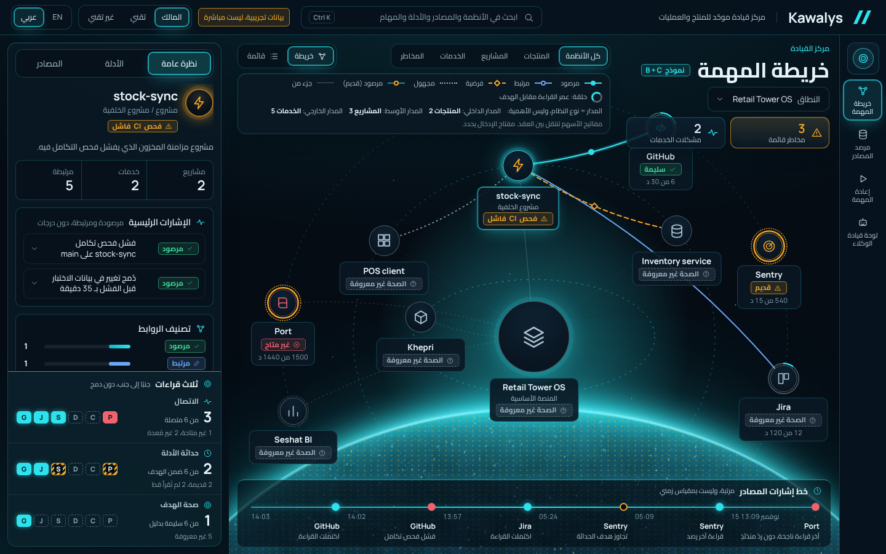
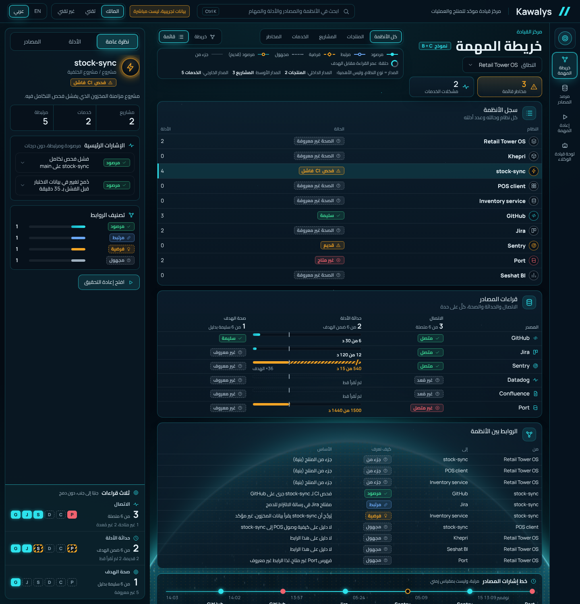
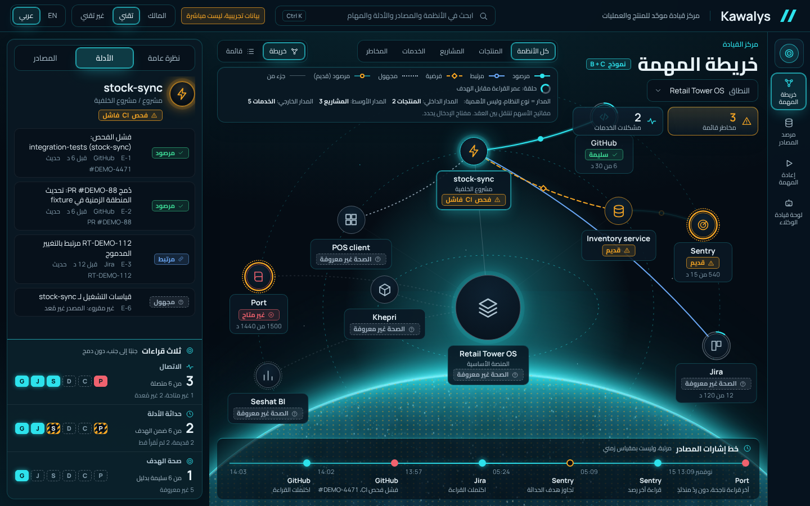
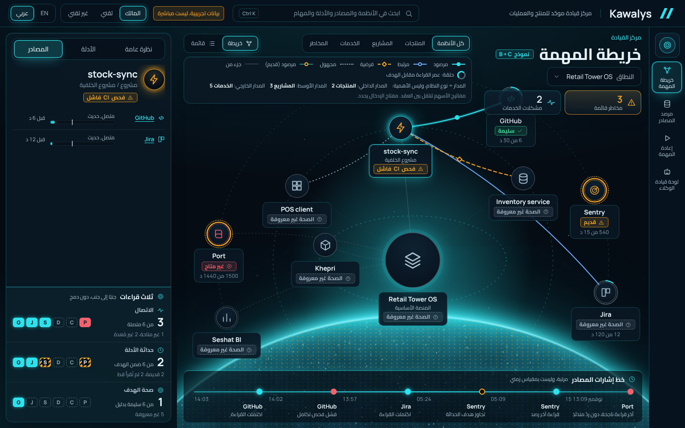
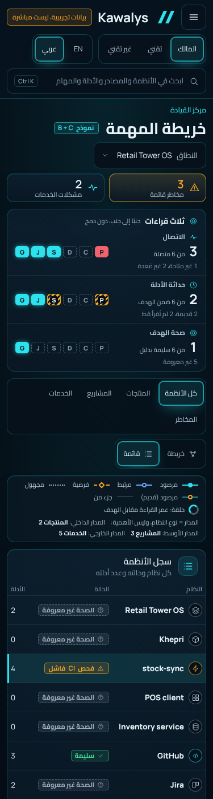
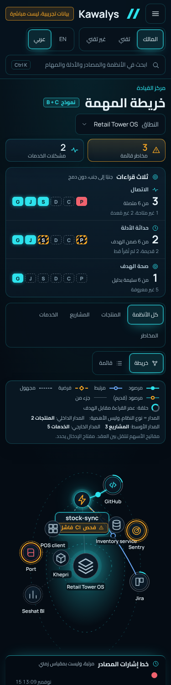

# BACK-31: Arabic review packet for the B+C pilot strings

Status: OPEN. This packet is ready for a native Arabic reviewer. No Arabic string has been changed, and none will be until the reviewer signs the block at the end. The ticket stays open until that block is filled.

Scope and rules:

- Source of truth: `app/src/design-lab/v2/i18n/bc.ts` (25 keys, EN and AR). Its header still says "NOT had a native-speaker review"; do not remove that line until a reviewer has signed below. Nothing in this change touches `bc.ts`.
- Demo data only. Nothing on these screens is live telemetry. The screenshots come from the synthetic world, built from the current branch (after BACK-30 and BACK-34).
- The "Machine pre-read (not a sign-off)" column is a list of questions for the reviewer, written by an automated read of the strings and of the neighbouring copy in `common.ts`, `map.ts`, `observatory.ts` and `replay.ts`. It does not say the Arabic is wrong. The reviewer decides each one.
- Latin runs inside Arabic strings are marked with `{braces}` in the source; the app turns them into left-to-right isolates. `$name` is a variable the app fills in. Digits are Latin in both languages.
- `edge.restricted` ("مبني على أدلة مقصورة على الفريق التقني") lives in `map.ts`, not `bc.ts`, and after BACK-30 it is no longer shown to any persona on the V2 map or B+C. The reviewer can skip it.

## How to review

1. Open the screenshots below, or run the lab and open a B+C URL (format `/v2.html?concept=bc&view=map|list[&tab=evidence|sources]#/mission-map?persona=owner&lang=ar&node=stock-sync`).
2. For each row in the strings table, fill "Reviewer verdict" (OK, change, or question) and, if you want a change, "Proposed edit". Answer the pre-read question if it applies.
3. Check the counter and date tables for plural and bidi behaviour.
4. Sign the block at the end.

## Screenshots (Arabic, RTL, synthetic data)

All captured in Chromium with Google Fonts blocked (offline), after the first-load intro finished. Files are in `docs/qa/kawalys-frontend/screens/BACK-31/`.

| Screenshot | What it shows |
|---|---|
|  | `bc-ar-desktop-map.png`: desktop map, Owner, node stock-sync selected, Overview tab. Legend, orbit key, hint, age captions, timeline. |
|  | `bc-ar-desktop-list.png`: desktop list view, Owner. Systems ledger and the start of the source-readings table. |
|  | `bc-ar-inspector-evidence.png`: inspector Evidence tab, Technical persona (the persona with the most evidence rows). |
|  | `bc-ar-inspector-sources.png`: inspector Sources tab, Owner. Age bars with "حديث" and age captions. |
|  | `bc-ar-mobile-list-375.png`: list view at 375 px (tall capture). Readings panel, ledger and matrix cards. |
|  | `bc-ar-phone-map-375.png`: map view at 375 px (tall capture). Readings, legend, orbit key, canvas, start of the timeline. |

## Strings table (generated)

Generated by a script that imports `bc.ts`, so the EN and AR columns are the exact current values. "Where it shows" was read from the components (`app/src/design-lab/v2/bc/*.tsx`, `screens/MissionMapBC.tsx`).

| # | Key | EN | AR (current) | Where it shows | Machine pre-read (not a sign-off) | Reviewer verdict | Proposed edit |
|---|---|---|---|---|---|---|---|
| 1 | `bc.concept` | {B + C} pilot | نموذج {B + C} | Page title chip next to "Mission Map" (map and list, both views) | Should the Latin token stay isolated in braces so it does not reorder beside Arabic? Does "نموذج" read as "pilot" to you, given that common.ts uses "مختبر" for the lab badge? | | |
| 2 | `bc.hint` | Arrow keys move between nodes. Enter selects. | مفاتيح الأسهم تنتقل بين العقد. مفتاح الإدخال يحدد. | Hint line under the legend, map view only | Is "تنتقل" the natural verb for moving focus between nodes, and "يحدد" the intended sense of select (versus "يختار")? Is "مفتاح الإدخال" the name you would use for Enter? | | |
| 3 | `bc.list.empty` | No systems match this filter. | لا أنظمة تطابق هذا المرشح. | Systems ledger, when the filter matches nothing (list view) | Does the opening "لا أنظمة" read naturally? Elsewhere filtering is "تصفية" (map.f.label, obs.f.label); is "المرشح" here an intended variation or should it follow? | | |
| 4 | `bc.links.empty` | No links match this filter. | لا روابط تطابق هذا المرشح. | Links table, when the filter matches nothing (list view) | Same question as `bc.list.empty`: "المرشح" versus "تصفية". Does "لا روابط" read naturally? | | |
| 5 | `bc.legend.stale` | Observed (stale) | مرصود (قديم) | Legend list, one item (map and list views) | "مرصود" matches `rp.st.observed` and "قديم" matches `chip.stale`. Does the parenthesis stay in the right place when the line is read in RTL? | | |
| 6 | `bc.legend.group` | Part of | جزء من | Legend list, one item | As a legend entry this is a fragment ("Part of"). Does "جزء من" read as a complete label, given `edge.group` says "جزء من المنتج (بنية)" and `map.legend.group` says "تجميع، بنية فقط"? | | |
| 7 | `bc.legend.ring` | Ring: read age vs target | حلقة: عمر القراءة مقابل الهدف | Legend list, ring key item | Is "مقابل" the right word for "versus" here, and does the colon after "حلقة" read naturally? | | |
| 8 | `bc.orbit.sub` | Orbit = kind of system, not importance | المدار = نوع النظام، وليس الأهمية | Orbit key line, before the three orbits | Does the "=" sign sit sensibly in an RTL sentence, or would you rather spell it out? Does "وليس الأهمية" carry the intended meaning? | | |
| 9 | `bc.orbit.inner` | Inner orbit | المدار الداخلي | Orbit key: "Inner orbit: Products N" | Does "المدار الداخلي" read well followed by a colon and the kind and count ("المنتجات 2")? Is the order of kind and number right in Arabic? | | |
| 10 | `bc.orbit.middle` | Middle orbit | المدار الأوسط | Orbit key: "Middle orbit: Projects N" | Same pattern as the inner orbit. Is "الأوسط" the form you would choose? | | |
| 11 | `bc.orbit.outer` | Outer orbit | المدار الخارجي | Orbit key: "Outer orbit: Services N" | Same pattern as the inner orbit. Is "الخارجي" the form you would choose? | | |
| 12 | `bc.ledger` | Systems ledger | سجل الأنظمة | List view: panel title and the region name (screen readers) of the ledger table | Is "سجل" the right word for a ledger-style table, given `view.table` uses "جدول"? This string is also the region name a screen reader announces. | | |
| 13 | `bc.ledger.sub` | Every system, its status and its evidence count | كل نظام وحالته وعدد أدلته | List view: subtitle under the ledger panel title | The pronouns ("وحالته", "أدلته") refer back to "نظام". Do they read correctly, and is "عدد أدلته" a natural way to say evidence count? | | |
| 14 | `bc.matrix` | Source readings | قراءات المصادر | List view: panel title and region name of the source-readings table | Does "قراءات المصادر" stay distinct from "ثلاث قراءات" (`obs.readings`) for you? Also the region name a screen reader announces. | | |
| 15 | `bc.matrix.sub` | Connectivity, freshness and health, each on its own | الاتصال والحداثة والصحة، كلٌّ على حدة | List view: subtitle under the matrix panel title | This string carries tanween ("كلٌّ") while the other strings carry no diacritics. Is that intended? Does "الصحة" match "صحة الهدف" used for the same axis in `obs.read.health`? | | |
| 16 | `bc.th.system` | System | النظام | First column heading of the ledger and the matrix | Is "النظام" clearly distinct from "الخدمة" and "المصدر" as column headings (`kind.service`, `kind.source`)? | | |
| 17 | `bc.of` | of $of $unit | من $of $unit | Readings panel and matrix column heads: "3 of 6 reachable" | The unit words come from `obs.pin.*.unit` and are feminine plural ("متصلة", "سليمة بدليل"). Does the sentence "3 من 6 متصلة" read naturally, and would the agreement hold for N = 0, 1, 2 or 11 if the source count ever changes? | | |
| 18 | `bc.readings.label` | Three readings of $n sources | ثلاث قراءات لـ $n مصادر | Accessible name of the Three readings panel (not visible text) | The plural word "مصادر" suits 3 to 10 only. Would N = 1, 2 or 11 need "مصدر واحد", "مصدران" or "مصدرًا"? Is the prefix "لـ" with a tatweel before a Latin digit intended? The demo always has 6 sources. | | |
| 19 | `bc.target` | target $m min | الهدف $m د | Age bar caption: "target 15 min" (and its accessible label) | Is the abbreviation "د" for minutes clear when a screen reader reads it aloud (it is the same abbreviation as `obs.read.age`)? Does "الهدف 15 د" read naturally? | | |
| 20 | `bc.over` | $x× target | $x× الهدف | Age bar caption when a source is 1.5x or more over target; also appended to the bar label | In RTL, does the "×" sit on the side you expect between the Latin digits and the Arabic word? Is "36× الهدف" understood as "36 times the target", and how does a screen reader say "×"? | | |
| 21 | `bc.never` | never read | لم تُقرأ قط | Age bar and node card when a source was never read | The verb is feminine ("تُقرأ") with an unstated subject; `obs.pin.fresh.sub` uses the same form for a plural count. Does it agree when it describes one source or one age? Is "قط" preferred over "أبدًا" (`obs.posture.sub` uses "أبدًا")? | | |
| 22 | `bc.f.current` | Current | حديث | Freshness word in the matrix and Sources tab | Is "حديث" the word you would use for a current reading (it sits beside "قديم"), or would another word fit better, given the target caption uses "ضمن الهدف"? | | |
| 23 | `bc.chip.unavailable` | Unavailable | غير متاح | Node status chip (map card, ledger row) when the source is unavailable | The same state is "غير متصل" (`obs.c.unavailable`, EN "Offline") in the matrix and "غير متاحة" in `obs.pin.conn.sub`. Is the difference between "متاح" and "متصل" intended? | | |
| 24 | `bc.chip.notset` | Not set up | غير مُعد | Node status chip when the source is not set up | This matches `obs.c.not_configured` ("غير مُعد"). Is "مُعد" the term you would use, or would "مهيأ" or another word be better? | | |
| 25 | `bc.tl.sub` | Ordered, not to time scale | مرتبة، وليست بمقياس زمني | Signal timeline subtitle (map view below the canvas, list view at the bottom) | The subject (events) is left out. Does "مرتبة" convey "ordered", and does the phrase match the longer `obs.tl.sub` ("متباعدة بالتساوي وليست بمقياس زمني") closely enough? | | |

## Counters: plural forms (generated)

The demo world always has 6 sources, so most of these values never appear on screen today. They are here so the reviewer can see how the templates behave for N = 0, 1, 2, 3 and 11, in case the source count changes. Each table sets the listed variables to N.

### `bc.readings.label` ($n = number of sources)

| N | EN | AR (current) |
|---|---|---|
| 0 | Three readings of 0 sources | ثلاث قراءات لـ 0 مصادر |
| 1 | Three readings of 1 sources | ثلاث قراءات لـ 1 مصادر |
| 2 | Three readings of 2 sources | ثلاث قراءات لـ 2 مصادر |
| 3 | Three readings of 3 sources | ثلاث قراءات لـ 3 مصادر |
| 11 | Three readings of 11 sources | ثلاث قراءات لـ 11 مصادر |

### `bc.of` ($of = N, unit = the Connectivity unit word)

| N | EN | AR (current) |
|---|---|---|
| 0 | of 0 reachable | من 0 متصلة |
| 1 | of 1 reachable | من 1 متصلة |
| 2 | of 2 reachable | من 2 متصلة |
| 3 | of 3 reachable | من 3 متصلة |
| 11 | of 11 reachable | من 11 متصلة |

### `bc.target` ($m = N minutes)

| N | EN | AR (current) |
|---|---|---|
| 0 | target 0 min | الهدف 0 د |
| 1 | target 1 min | الهدف 1 د |
| 2 | target 2 min | الهدف 2 د |
| 3 | target 3 min | الهدف 3 د |
| 11 | target 11 min | الهدف 11 د |

### `bc.over` ($x = N)

| N | EN | AR (current) |
|---|---|---|
| 0 | 0× target | 0× الهدف |
| 1 | 1× target | 1× الهدف |
| 2 | 2× target | 2× الهدف |
| 3 | 3× target | 3× الهدف |
| 11 | 11× target | 11× الهدف |

### `obs.read.age` (reused by B+C: $a of $m min, $m = 15)

| N | EN | AR (current) |
|---|---|---|
| 0 | 0 of 15 min | 0 من 15 د |
| 1 | 1 of 15 min | 1 من 15 د |
| 2 | 2 of 15 min | 2 من 15 د |
| 3 | 3 of 15 min | 3 من 15 د |
| 11 | 11 of 15 min | 11 من 15 د |

### `obs.pin.conn.sub` (reused: $u = N, $c = N)

| N | EN | AR (current) |
|---|---|---|
| 0 | 0 unavailable, 0 not set up | 0 غير متاحة، 0 غير مُعدة |
| 1 | 1 unavailable, 1 not set up | 1 غير متاحة، 1 غير مُعدة |
| 2 | 2 unavailable, 2 not set up | 2 غير متاحة، 2 غير مُعدة |
| 3 | 3 unavailable, 3 not set up | 3 غير متاحة، 3 غير مُعدة |
| 11 | 11 unavailable, 11 not set up | 11 غير متاحة، 11 غير مُعدة |

### `obs.pin.fresh.sub` (reused: $s = N, $k = N)

| N | EN | AR (current) |
|---|---|---|
| 0 | 0 stale, 0 never read | 0 قديمة، 0 لم تُقرأ قط |
| 1 | 1 stale, 1 never read | 1 قديمة، 1 لم تُقرأ قط |
| 2 | 2 stale, 2 never read | 2 قديمة، 2 لم تُقرأ قط |
| 3 | 3 stale, 3 never read | 3 قديمة، 3 لم تُقرأ قط |
| 11 | 11 stale, 11 never read | 11 قديمة، 11 لم تُقرأ قط |

### `obs.pin.health.sub` (reused: $n = N)

| N | EN | AR (current) |
|---|---|---|
| 0 | 0 unknown | 0 غير معروفة |
| 1 | 1 unknown | 1 غير معروفة |
| 2 | 2 unknown | 2 غير معروفة |
| 3 | 3 unknown | 3 غير معروفة |
| 11 | 11 unknown | 11 غير معروفة |

Questions for the reviewer on counters: the Arabic templates use one fixed noun form ("مصادر", "متصلة", "قديمة", "غير معروفة"). Which of the N values above need a different form, and should the product ever need one, would you prefer separate strings per number class or a rewording that avoids agreement?

## Date format sample (generated)

`formatAt` in `app/src/design-lab/v2/logic/bc.ts` prints just the time when the event is on the world's current day, and "day month time" otherwise, with Latin digits and an Arabic month name. Sample with the world clock set to 16 November 2026:

| ISO | now | EN | AR |
|---|---|---|---|
| 2026-11-16T14:03:00Z | 2026-11-16T15:00:00Z | 14:03 | 14:03 |
| 2026-11-15T13:09:00Z | 2026-11-16T15:00:00Z | 15 Nov 13:09 | 15 نوفمبر 13:09 |
| 2026-12-03T09:05:00Z | 2026-11-16T15:00:00Z | 3 Dec 09:05 | 3 ديسمبر 09:05 |
| 2026-01-08T23:40:00Z | 2026-11-16T15:00:00Z | 8 Jan 23:40 | 8 يناير 23:40 |

Questions for the reviewer: does "15 نوفمبر 13:09" read correctly in RTL (day, month, time order and the Latin colon)? Are the month names the forms you would choose (the app uses "نوفمبر", "ديسمبر", "يناير" and so on)? The time is wrapped in a left-to-right isolate in the timeline; is that enough, or should the date part be isolated too?

## Cross-cutting questions

- Terminology: the neighbouring copy filters with "تصفية" while `bc.list.empty` and `bc.links.empty` say "المرشح". Which one is right for this product?
- Connectivity words: the same "unavailable" state appears as "غير متاح" (node chip), "غير متصل" (matrix cell, `obs.c.unavailable`) and "غير متاحة" (readings sub-line). Is the mix intended?
- Diacritics: only `bc.matrix.sub` carries tanween. Do you want diacritics in none, some or all strings?
- Abbreviations and symbols: "د" for minutes and "×" for "times" appear in captions and in the accessible names of age bars. Do they read well aloud?

## Sign-off

Complete this block when the review is done. Until it is filled, BACK-31 stays open and `bc.ts` keeps its "not reviewed" header.

| Field | Value |
|---|---|
| Reviewer name | |
| Reviewer qualification (native Arabic speaker, region) | |
| Date | |
| Decision (approved as is / approved with the edits listed above / rejected) | |
| Number of rows with a proposed edit | |
| Notes | |

After sign-off, a developer applies the approved edits to `bc.ts` in a separate change, keeps `copy.test.ts` green and only then updates the header.
